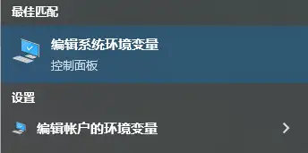
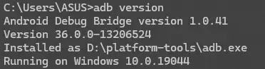

# 前言
Android 调试桥（ADB，Android Debug Bridge）是一款功能强大的命令行工具，用于与 Android 设备进行通信。通过 `adb` 命令，您可以执行多种设备操作，如安装和调试应用，还可以访问设备上的 Unix Shell，直接在设备中运行各类命令。  
ADB 采用客户端-服务器架构，由三个核心组件构成：
- **客户端（Client）**：运行在开发主机上，负责发送命令。用户可通过终端输入 `adb` 命令来调用该客户端。
- **守护进程（adbd）**：运行在设备上，负责执行命令。该守护进程以后台服务的形式运行于每一台连接的 Android 设备中。
- **服务器（Server）**：运行在开发主机上，负责管理客户端与设备端守护进程之间的通信，并在后台持续监听来自客户端的请求。
# 正式开启
## 1. 下载 SDK Platform-Tools
访问 [SDK 平台工具版本说明](https://developer.android.google.cn/tools/releases/platform-tools?hl=zh-cn#downloads) 页面，点击 `下载内容` 下方的 `下载适用于 Windows 的 SDK Platform-Tools` 按钮。在弹出的窗口中勾选 `我已同意上述条款及条件`，即可开始下载。
## 2. 解压与配置环境变量
1. 下载完成后，您将得到一个名为 `platform-tools-latest-windows.zip` 的压缩包。将这个压缩包解压到任意位置。
2. 使用 Windows 搜索功能，输入 `环境变量`，然后选择 `编辑系统环境变量`。
   
3. 点击 `环境变量(N)...`，在 `XXX 的用户变量(U)` 区域找到 `Path` 变量，点击 `编辑`。
4. 在编辑窗口中，点击 `新建(N)`，然后输入 `platform-tools` 文件夹的完整路径。例如： `C:\Downloads\platform-tools-latest-windows\platform-tools`。
## 3. 验证配置是否成功
配置完成后，按 `Win + R`，输入 `cmd` 并回车，打开命令提示符窗口。在其中执行以下命令：
```bash
adb version
```
如果正确显示 ADB 的版本信息（例如 `Android Debug Bridge version 1.0.41`），则说明环境变量配置成功，ADB 已可正常使用。


> 如果提示 'adb' 不是内部或外部命令，也不是可运行的程序或批处理文件。  
> 请检查路径是否输入正确，并确保已重启命令行窗口。
