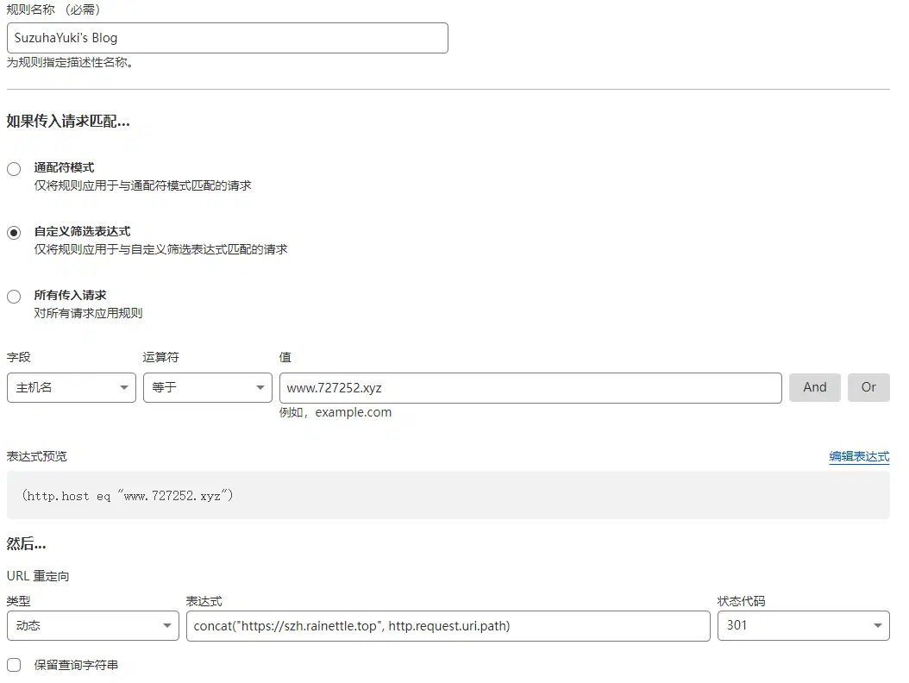

# 使用 Cloudflare 实现域名重定向
当你更换了域名，或者希望将多个域名统一指向同一个站点时，域名重定向是最常用的手段。借助 Cloudflare 的**重定向规则**，无需额外的服务器，只需几步配置即可实现。
## 整体流程
1. 添加 DNS 记录并启用 Cloudflare 代理
2. 创建重定向规则，匹配源域名并指向目标地址
## 第一步：配置 DNS 记录
登录 Cloudflare 控制面板，进入目标域名的 **DNS** 管理页面，添加一条 A 记录：
- **名称**：填写子域名(如`www`)
- **IPv4地址**：8.8.8.8
- **代理状态**：点亮小黄云，即设置为 **已代理**。

> **代理状态必须开启**：只有当流量经过 Cloudflare（小黄云亮起），重定向规则才能被触发。如果使用 DNS Only（灰色云朵），流量直接到达源服务器，Cloudflare 无法介入。


## 第二步：创建重定向规则
1. 进入 **规则** > **概述** 页面，点击 **创建规则**，选择 **重定向规则**。
2. 配置匹配条件——**如果传入请求匹配…**：  
   选择 **自定义筛选表达式**，设置如下：
	- **字段**：`主机名`
	- **运算符**：`等于`
	- **值**：填入你希望被重定向的原始完整域名（例如 `www.727252.xyz`）
3. 配置重定向动作——**然后…**：
	- **类型**：`动态`  
	- **表达式**：
	```javascript
	concat("https://新域名", http.request.uri.path)
	```
	- **示例**：
	```javascript
	concat("https://szh.rainettle.top", http.request.uri.path)
	```
	- **状态代码**：`301`

	> **说明**：
	> - **301 Moved Permanently（永久重定向）**  
	> 	资源已被**永久**移至新 URL。客户端应更新书签或链接，后续请求直接使用新地址。多数浏览器会将原始请求方法（如 `POST`）自动转换为 `GET`。 
	> - **302 Found（临时重定向）**   
	> 	资源**临时**位于另一个 URL。客户端应继续使用原地址发起后续请求。尽管规范未强制，但实际中浏览器通常会将 `POST` 等非 `GET` 请求转为 `GET` 重定向。
	> - **303 See Other（查看其他位置）**  
	> 	响应可在另一个 URI 获取，且**必须使用 `GET` 方法**访问该 URI。常用于表单提交后重定向到结果页，以避免刷新导致重复提交。 
	> - **307 Temporary Redirect（临时重定向，方法不变）**  
	>	资源临时迁移，但客户端**必须保持原始请求方法和请求体不变**（如 `POST` 仍为 `POST`），重新向新地址发送请求。
	> - **308 Permanent Redirect（永久重定向，方法不变）**  
	> 	资源已被**永久**移至新 URL，且**必须保留原始请求方法和请求体**。是 301 的严格版本，适用于需要保证请求语义完整的 API 迁移场景。


4. 检查所有配置项无误后，点击底部的 **部署** 按钮。规则通常在几秒内生效。
