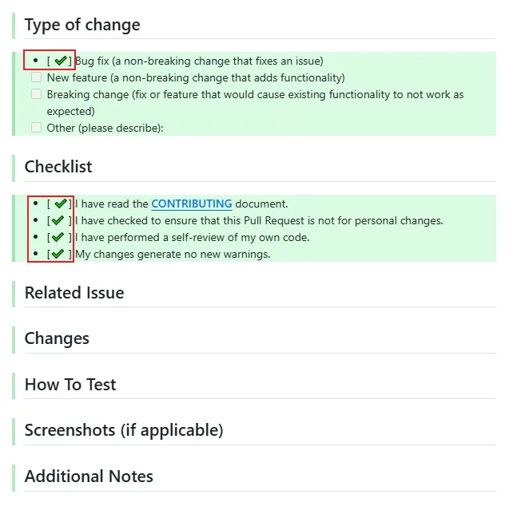
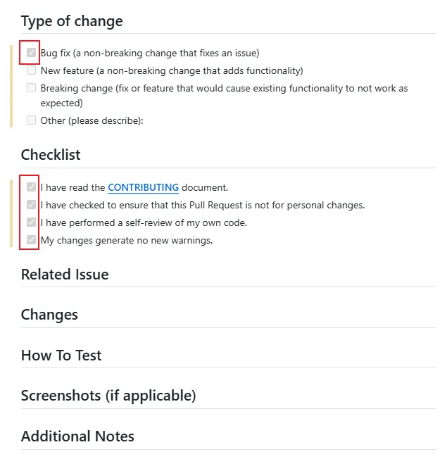
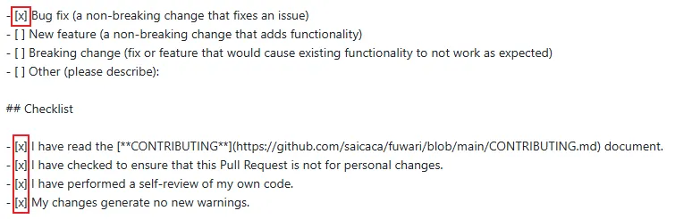

# 你的 PR 模板 checkbox 写错了

见过这种 PR 模板没？checklist 那一栏，勾选项是 `• [✓]`。  
这不是 checkbox。这就是个列表项后面跟了个带括号的 ✓，纯文本，点都点不动。  
正确的：


```markdown
- [x] Bug fix (a non-breaking change that fixes an issue)
- [ ] New feature (a non-breaking change that adds functionality)
- [ ] Breaking change
- [ ] Other (please describe):

## Checklist
- [x] I have read the [CONTRIBUTING](https://github.com/saicaca/fuwari/blob/main/CONTRIBUTING.md) document.
- [x] I have checked to ensure that this Pull Request is not for personal changes.
- [x] I have performed a self-review of my own code.
- [x] My changes generate no new warnings.
```
GFM task list 就一行：`- [x]` 已完成，`- [ ]` 未完成。渲染出来是真正的 checkbox，能点。  
用 `[✓]` 的话，贡献者打勾得手动编辑文本，CI bot 也当普通文字跳过。`✓` 在不同系统上长得还不一样，缺字体变方块我都见过。模板里这么写，新来的照着抄，后面到处都是这种东西。
```markdown
## Type of change
- [ ] Bug fix
- [ ] New feature
- [ ] Breaking change
- [ ] Other:

## Checklist
- [ ] I have read the CONTRIBUTING document.
- [ ] This PR is not for personal changes.
- [ ] I have performed a self-review of my code.
- [ ] My changes generate no new warnings.
```
默认 `- [ ]`，别帮人预勾。