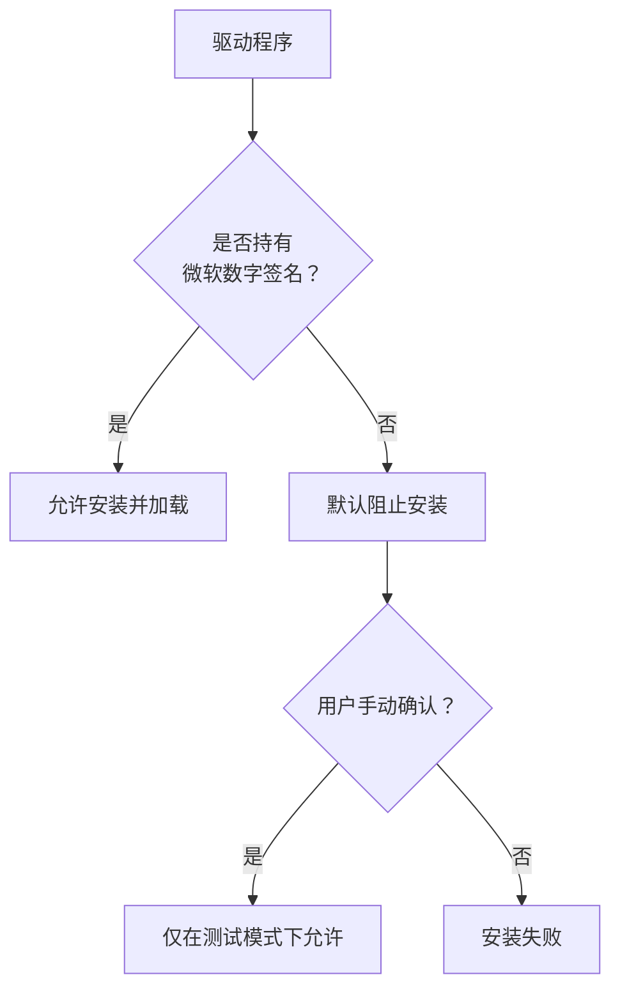

# 前言
刚装完 Windows，屏幕分辨率不对、没声音、连不上 Wi-Fi——这些问题的根源往往是**驱动程序缺失**。驱动程序是操作系统与硬件之间的翻译官，没有它，再强大的硬件也只是一堆沉默的硅片。
# 什么是驱动程序
## 基本概念
驱动程序（Device Driver）是一种使计算机与硬件设备进行通信的特殊程序。操作系统通过驱动程序提供的接口来控制硬件设备的工作。如果某设备的驱动程序未能正确安装，该设备便无法正常工作。  
## 驱动程序在系统中的位置

| 层级 | 组件 | 权限级别 |
|:----:|:----|:----:|
| 用户层 | 应用程序 | 低 |
| 系统层 | 操作系统（Windows 内核） | 高 |
| **驱动层** | **设备驱动程序** | **高（内核态）** |
| 硬件层 | 物理设备 | — |

> [!WARNING]
> 驱动程序运行在内核态，拥有与操作系统相同的权限。安装来源不明的驱动相当于给系统开了一道后门。务必从官方或可信渠道获取驱动。
# 驱动程序分类
## 按功能分类

| 类型 | 说明 | 示例 |
|:----:|:----|:----|
| 显示驱动 | 控制显卡输出画面 | NVIDIA / AMD / Intel 显卡驱动 |
| 网络驱动 | 管理有线 / 无线网络通信 | Wi-Fi 适配器、以太网卡驱动 |
| 声音驱动 | 处理音频输入输出 | Realtek HD Audio、NVIDIA HDMI Audio |
| 芯片组驱动 | 管理主板各组件间的通信 | Intel Chipset、AMD Chipset |
| 存储驱动 | 控制硬盘、SSD 等存储设备 | NVMe Controller、RAID 驱动 |
| USB 驱动 | 管理 USB 设备的识别与通信 | USB 3.x 主控驱动 |
| 蓝牙驱动 | 管理蓝牙设备的配对与通信 | Intel Bluetooth、Realtek Bluetooth |
| 打印驱动 | 将打印任务发送至打印机 | 各品牌打印机驱动 |

## 驱动签名机制

Windows 通过 **驱动签名强制（Driver Signature Enforcement）** 来保证驱动安全性：



> [!NOTE]
> 64 位 Windows 默认强制要求驱动签名。这意味着所有通过正常渠道安装的驱动都必须经过微软的数字签名认证。这一机制有效防止了恶意驱动的加载。
# 驱动安装
## 系统自动安装
Windows 10/11 安装镜像（约 4 ~ 5 GB）内置了**通用驱动程序库**。系统首次启动时，会在后台自动为已检测到的硬件设备安装适配的驱动程序，确保基本功能正常运行。  
这种方式安装的驱动通常版本较旧，但胜在**稳定兼容**，足以让系统完成基本初始化。
## 手动下载安装
对于显卡、芯片组等核心驱动，建议从**官方网站**下载最新版本。
### 显卡驱动

| 厂商 | 官方下载地址 | 自动检测工具 |
|:----:|:----|:----:|
| NVIDIA | [GeForce 驱动](https://www.nvidia.cn/geforce/drivers/) | GeForce Experience |
| AMD | [AMD 驱动支持](https://www.amd.com/zh-hans/support) | AMD Adrenalin |
| Intel | [Intel 驱动与支持](https://www.intel.cn/content/www/cn/zh/download-center/home.html) | Intel Driver & Support Assistant |

### 其他硬件驱动

| 设备类型 | 推荐下载渠道 |
|:----:|:----|
| 主板 | 品牌官网支持页面（华硕、微星、技嘉等） |
| 笔记本 | 笔记本品牌官网（联想、戴尔、惠普等） |
| 打印机 | 打印机品牌官网支持页面 |
| 网卡 / 声卡 | 主板官网或芯片厂商官网 |

> [!TIP]
> 搜索驱动时建议安装广告拦截工具（如 [AdGuard](https://adguard.com/zh_cn/welcome.html)），避免误入第三方驱动下载站——这些站点经常捆绑恶意软件或提供过期甚至伪造的驱动。
# 注意事项
## 下载路径 & 安装位置选择
将驱动安装包放在**纯英文路径**下，避免因路径包含中文字符导致安装失败。
```
推荐：C:\Drivers\NVIDIA\
不推荐：C:\下载\显卡驱动\
```
对于显卡、芯片组等核心驱动，**强烈建议使用默认安装路径**。不要为了节省 C 盘空间而随意更改安装位置。
## 驱动更新策略

| 场景 | 是否需要更新 | 说明 |
|:----:|:----:|:----|
| 系统运行稳定，硬件全部正常 | 不需要 | "能跑就别动"是驱动的黄金法则 |
| 出现蓝屏、卡顿等硬件异常 | 需要 | 可能是驱动 Bug，更新可能修复 |
| 新游戏 / 软件提示需更新驱动 | 需要 | 新软件通常依赖新版驱动的特性 |
| 安全漏洞公告 | 需要 | 尤其是网卡、存储等关键驱动 |
| 显卡驱动发布 Game Ready 版本 | 按需 | 专为某款新游戏优化，喜欢该游戏可更新 |

> [!WARNING]
> **不要盲目追求最新驱动。** 新版驱动的主要目标是适配新发布的硬件和修复已知问题。对于老硬件和稳定环境，新版驱动有时反而可能引入新的兼容性风险或 Bug。如果当前一切正常，保持现状往往是最稳妥的选择。
## 常见问题排查

| 故障现象 | 可能原因 | 解决方案 |
|:----:|:----:|:----|
| 设备管理器显示黄色感叹号 | 驱动缺失或损坏 | 右键更新驱动 / 重新安装 |
| 设备管理器显示红色叉号 | 设备被禁用 | 右键 → 启用设备 |
| 更新驱动后蓝屏 | 新驱动与系统不兼容 | 进入安全模式，回滚驱动 |
| 显卡性能突然下降 | 驱动异常 / 被切换为集显 | 检查显示适配器列表，重装驱动 |
| 声音设备消失 | 声卡驱动丢失 | 设备管理器中扫描硬件变动 |
| USB 设备无法识别 | USB 驱动异常 | 卸载 USB 主控驱动后重启 |

# 总结
驱动程序是连接操作系统与硬件的关键桥梁。管理驱动的核心原则可以概括为三点：
1. **来源可靠** — 优先使用系统自带驱动和官方渠道下载，不信任第三方驱动站
2. **稳定优先** — 没有问题就不要更新，更新前阅读更新日志评估收益
